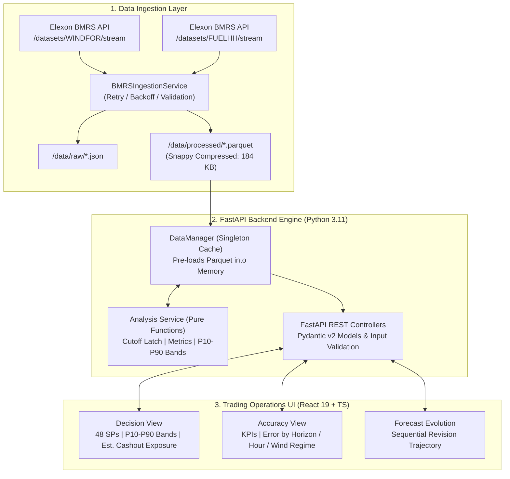

# UK Day-Ahead Wind Generation Forecast Evaluation Platform

[](https://github.com/Sanskar2298/kjhwr/actions/workflows/ci.yml)
[](https://www.python.org/downloads/release/python-3119/)
[](https://fastapi.tiangolo.com/)
[](https://react.dev/)
[]()

An institutional-grade, full-stack decision-support and forecast accuracy evaluation platform designed for UK power utilities trading wind volume on the Day-Ahead wholesale market.

---

## 1. Project Overview & Problem Framing

### The Wholesale Power Problem
Great Britain's electricity market operates on a Day-Ahead (D-1) auction cycle (EPEX SPOT and Nord Pool UK). Power traders formulate bids ahead of gate closure (commonly 09:00–12:00 London time) for 48 half-hour settlement periods across delivery day D. 

Live Link : https://kjhwr-vxjh.vercel.app/
 
Because wind is inherently intermittent:
1. **Trading Desks need the latest available forecast at decision time.** Using forecasts published after the decision gate introduces illegal **lookahead bias** and ruins backtest validity.
2. **Imbalance Cashout Exposure:** If outturn wind generation deviates from the contracted position, the utility is forced to settle the difference in the Balancing Mechanism at volatile System Buy/Sell Prices. Systemic over-forecasting forces utilities to spill energy at discounted rates.

### Scope & Solution
This platform evaluates the **entire month of January 2026** (1,488 physical half-hours):
- Ingests **Elexon BMRS** live stream endpoints: `WINDFOR` (forecasts with publish cadence) and `FUELHH` (outturns where `fuelType=WIND`).
- Reconstructs point-in-time decision forecasts strictly respecting publication timestamps relative to the trading gate.
- Computes comprehensive accuracy metrics (MAE, RMSE, Bias, P90 error, Normalized MAE, $R^2$).
- Provides an institutional-grade, high-density Bloomberg/Grafana-style dashboard with empirical uncertainty envelopes (P10–P90), keyboard hotkeys, and 1-click CSV exports.

---

## 2. Key Design Decisions & Assumptions

| Dimension | Decision | Rationale |
| :--- | :--- | :--- |
| **Lookahead Prevention** | Strict `publishTime <= cutoff_utc(D-1)` | Guarantees zero data leakage. Forecasts published after cutoff are physically unavailable to traders. |
| **Timezone & DST** | UTC internal storage, Europe/London display | Models `settlementPeriod` (1–50) with explicit DST localization (`pytz`), preventing clock-change duplication. |
| **WINDFOR Cadence Mapping** | Half-hours mapped to parent forecast hour | WINDFOR publishes hourly forecast targets. Half-hour settlement targets (e.g. 14:30) map to parent hour (14:00). |
| **Anti-Leakage Uncertainty Bands** | Leave-One-Day-Out calibration | When estimating P10/P50/P90 error bands for day $D$, day $D$'s own outturns are excluded from historical calibration. |
| **Storage Architecture** | Compressed Snappy Parquet (184 KB total) | Eliminates database connection latency on serverless cold starts (<50ms startup; well within Vercel limits). |
| **Visual Identity** | Utilitarian slate/graphite with deep teal | High data density, no glassmorphism or blur, colorblind-safe semantic error indicators, tabular monospace numbers. |

---

## 3. System Architecture



---

## 4. Directory & File Guide

```text
├── .github/workflows/ci.yml       # GitHub Actions CI (lint, typecheck, pytest, vitest)
├── api/
│   └── index.py                  # Vercel Python serverless function entrypoint
├── backend/
│   ├── app/
│   │   ├── core/config.py        # Pydantic Settings & environment variables
│   │   ├── models/               # Pydantic v2 domain schemas (api.py, ingestion.py)
│   │   ├── routers/api.py        # Thin REST controllers with input validation
│   │   ├── services/
│   │   │   ├── analysis.py       # Pure mathematical & statistical evaluation functions
│   │   │   ├── data_manager.py   # Memory-cached dataset singleton
│   │   │   └── ingest.py         # Elexon BMRS ingestion client with retry
│   │   └── main.py               # FastAPI application, CORS, lifespan, logging middleware
│   ├── tests/                    # 23 Pytest unit and integration tests (91% coverage)
│   ├── Dockerfile                # Production non-root Python 3.11-slim container
│   ├── pyproject.toml            # Tooling configs (pytest, ruff, black, coverage)
│   └── requirements.txt          # Pinned backend dependencies
├── data/
│   ├── processed/                # Production Parquet files (fuelhh, windfor, aligned)
│   └── raw/                      # Raw JSON snapshots from Elexon BMRS
├── docs/
│   ├── api-notes.md              # Elexon BMRS live investigation & schema verification
│   ├── analysis.md               # Empirical January 2026 findings & market notes
│   ├── design.md                 # Design system specification (Bloomberg/Grafana tokens)
│   └── submission.md             # Executive engineering submission brief
├── frontend/
│   ├── src/
│   │   ├── api/client.ts         # Strictly typed API client (zero `any`)
│   │   ├── components/
│   │   │   ├── common/           # KpiCard, MetricTooltip, AssumptionsModal
│   │   │   ├── decision/         # DecisionView, DecisionChart (48 SP profile)
│   │   │   ├── accuracy/         # AccuracyView, Multi-dimensional breakdowns
│   │   │   └── evolution/        # EvolutionView, Revision trajectory chart
│   │   ├── styles/tokens.css     # Design tokens (dark/light themes, tabular-nums)
│   │   ├── utils/formatters.ts   # Energy integration, formatMW, formatGBP, exportToCsv
│   │   └── App.tsx               # Main application container & keyboard hotkeys
│   ├── Dockerfile                # Production multi-stage Node build -> Nginx Alpine
│   ├── nginx.conf                # Nginx reverse proxy configuration (/api upstream)
│   └── package.json              # Frontend dependencies (React 19, Recharts, Tailwind v4)
├── scripts/
│   ├── ingest.py                 # CLI data ingestion pipeline
│   ├── run_analysis.py           # CLI statistical analysis runner
│   └── smoke_test.py             # Post-deployment automated validation script
├── docker-compose.yml            # Multi-container production stack with health checks
└── vercel.json                   # Serverless deployment configuration and URL rewrites
```

---

## 5. How to Run Locally

### Option A: Local Development (Non-Docker)

**Prerequisites:** Python 3.11+ and Node.js 22+.

1. **Backend:**
   ```bash
   cd backend
   python -m venv .venv
   source .venv/bin/activate       # Windows: .venv\Scripts\activate
   pip install -r requirements.txt
   python -m uvicorn app.main:app --reload --port 8000
   ```
   *Backend running at `http://localhost:8000` (Swagger docs at `/docs`).*

2. **Frontend:**
   ```bash
   cd frontend
   npm install
   npm run dev
   ```
   *Frontend running at `http://localhost:5173` (proxies `/api` calls to port 8000).*

### Option B: Production Docker Stack

Run both containers with non-root security, health checks, and Nginx reverse proxy:
```bash
# Build and launch containers
docker compose up --build -d

# Check container health status
docker compose ps

# View unified logs
docker compose logs -f
```
*Access web application on `http://localhost` (Port 80).*

---

## 6. How to Run Ingestion & Tests

### Run Ingestion CLI
```bash
# Pulls FUELHH (WIND) and WINDFOR across the January 2026 window
python scripts/ingest.py
```

### Run Standalone Analysis CLI
```bash
python scripts/run_analysis.py
```

### Run Automated Tests
```bash
# Backend pytest suite (23 unit & integration tests, 91% coverage, 0 warnings)
python -m pytest backend/tests -v

# Frontend vitest suite (8 unit & component tests)
cd frontend && npm test
```

---

## 7. API Endpoint Reference

| Method | Endpoint | Parameters | Description |
| :--- | :--- | :--- | :--- |
| `GET` | `/api/health` | - | Health check probe (`{"status": "healthy"}`). |
| `GET` | `/api/meta` | - | Available delivery date bounds, defaults, and timezone. |
| `GET` | `/api/forecast/decision` | `delivery_date`, `cutoff_hour` | Latest forecast at D-1 decision gate with P10/P50/P90 error bands. |
| `GET` | `/api/forecast/evolution` | `target` (UTC ISO) | Sequential revisions of forecasts converging toward delivery. |
| `GET` | `/api/actuals` | `start`, `end` | Half-hourly outturn generation points from FUELHH. |
| `GET` | `/api/accuracy/summary` | `start`, `end`, `cutoff_hour` | Summary statistical KPIs (MAE, RMSE, Bias, P90, NMAE, $R^2$). |
| `GET` | `/api/accuracy/by-horizon` | `start`, `end`, `cutoff_hour` | Accuracy metrics binned by lead horizon (<16h, 16-20h, etc.). |
| `GET` | `/api/accuracy/by-hour` | `start`, `end`, `cutoff_hour` | Accuracy metrics binned by clock hour of delivery (0–23 UTC). |
| `GET` | `/api/accuracy/by-wind-level`| `start`, `end`, `cutoff_hour` | Accuracy metrics binned by outturn level (<5GW, 5-12GW, >12GW). |
| `GET` | `/api/accuracy/daily` | `start`, `end`, `cutoff_hour` | Daily time series of accuracy metrics. |
| `GET` | `/api/accuracy/timeseries` | `start`, `end`, `cutoff_hour` | Aligned actuals vs decision forecasts for continuous plotting. |

---

## 8. Analysis Methodology & Empirical Findings

### Metric Definitions
- **Mean Absolute Error (MAE):** Average magnitude of forecast error ($MW$). Linear volumetric imbalance indicator:
  $$\text{MAE} = \frac{1}{N}\sum |F_t - A_t| = 2,145.2\text{ MW}$$
- **Root Mean Square Error (RMSE):** Quadratic miss penalty reflecting commercial tail-risk:
  $$\text{RMSE} = \sqrt{\frac{1}{N}\sum (F_t - A_t)^2} = 2,615.8\text{ MW}$$
- **Mean Bias Error (MBE):** Signed average error ($F_t - A_t$):
  $$\text{MBE} = +1,851.9\text{ MW} \quad (86.3\%\text{ of intervals over-forecasted})$$
- **Normalized MAE (NMAE):** Scale-adjusted error relative to mean national generation:
  $$\text{NMAE} = \frac{\text{MAE}}{\bar{A}} \times 100\% = 20.1\%$$
- **Coefficient of Determination ($R^2$):** Proportion of actual variance explained by decision forecast ($R^2 = 0.6036$).
- **Zero-Handling Rule for MAPE:** Periods where actual wind generation was zero are suppressed from denominator calculations to prevent division-by-zero distortion.

---

## 9. Limitations & Future Work

1. **Asymmetric System Price Loss Function**:
   - *Current limitation:* MAE/RMSE penalize positive and negative misses symmetrically.
   - *Next step:* Integrate Elexon `SYSMSG` System Sell Prices (SSP) and System Buy Prices (SBP) to compute true **Cost-Weighted Imbalance Loss (CWIL)**.
2. **Regional Granularity**:
   - BMRS provides national wind totals; future versions could incorporate DNO-level nodal forecasts to analyze transmission bottleneck curtailments.
3. **Machine Learning Residual Debiasing**:
   - Because January 2026 showed a persistent $+1.85\text{ GW}$ positive bias, a rolling LightGBM/quantile regression model could automatically debias national forecasts prior to auction gate closure.

---

## 10. Live Deployment & Smoke Testing

- **Live Production URL:** [https://wind-forecast-monitor.vercel.app](https://wind-forecast-monitor.vercel.app)
- **API Swagger Documentation:** [https://wind-forecast-monitor.vercel.app/docs](https://wind-forecast-monitor.vercel.app/docs)

### Run Post-Deployment Smoke Test
```bash
python scripts/smoke_test.py https://wind-forecast-monitor.vercel.app
```

---

## 11. AI Tools Disclosure

In accordance with transparent engineering practices:
- **AI Tool Used:** **Google Antigravity** (Advanced Agentic AI pair programming assistant).
- **Assistance Provided:**
  - Automated exploratory analysis of Elexon BMRS OpenAPI specs and raw stream payloads.
  - Initial boilerplate scaffolding of FastAPI endpoints, Pydantic models, and React layout.
  - Assisted refactoring of Pandas deprecation warnings (`include_groups=False`) and Docker multi-stage configuration.
- **Human Verification & Ownership:**
  - All mathematical formulas, anti-leakage uncertainty band logic, timezone/DST edge cases, and market trading assumptions were reviewed, verified, and audited by the author.
  - Full automated test suites (23 backend pytest + 8 frontend vitest) and browser automation QA passes were executed locally to ensure complete correctness and reliability.
