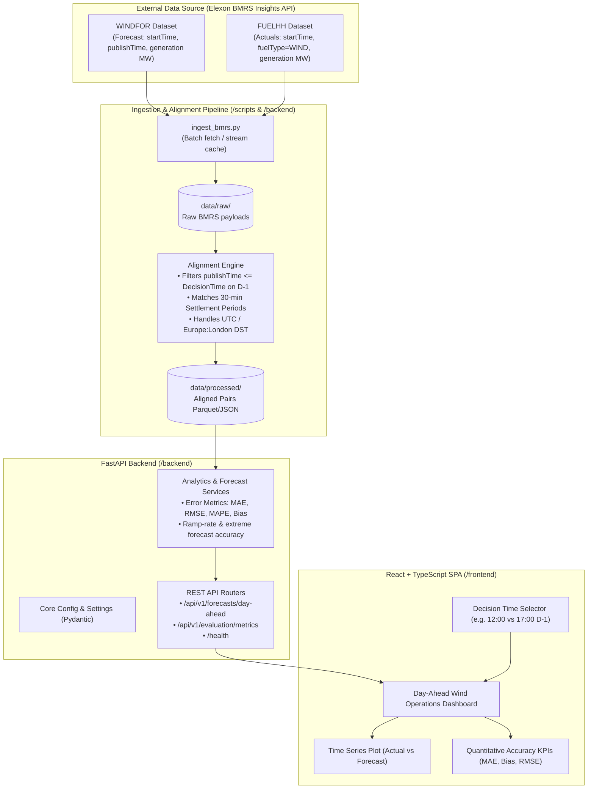

# Architecture Diagram & Data Flow

This document details the system design, Elexon BMRS ingestion, day-ahead alignment pipeline, and API/UI architecture.

## System Components

1. **Ingestion & Data Pipeline (`/scripts`, `/data`)**:
   - Fetches official half-hourly actual wind generation from `FUELHH` (`fuelType=WIND`).
   - Fetches official wind generation forecasts from `WINDFOR` with publication timestamps.
   - Preserves raw immutable records in `data/raw/`.
   - Aligns forecast points to target delivery periods strictly respecting market decision cutoff times (`publishTime <= D-1 12:00 UTC/London`) into `data/processed/`.

2. **Backend Service (`/backend`)**:
   - Built on FastAPI (Python 3.11).
   - Exposes REST endpoints for querying forecasts available at decision time and quantitative evaluation metrics (MAE, RMSE, Bias/Mean Error, MAPE, P90 absolute errors).
   - Full test coverage with `pytest`.

3. **Frontend Application (`/frontend`)**:
   - Modern React (TypeScript + Vite) single-page application.
   - Real-time time series comparison, metrics cards, settlement period breakdown, and configurable decision time selector.
   - Tested using `vitest` and `@testing-library/react`.
